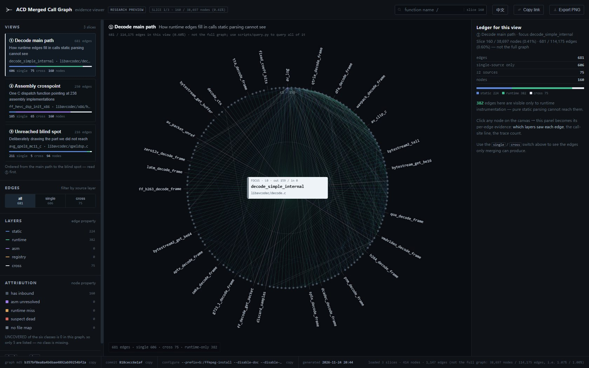

# ACD — a multi-source fused function-level call graph

> 中文 → [README.md](README.md) ｜ 中文导读（八节） → [导读.md](导读.md) ｜ **English guide → [GUIDE.en.md](GUIDE.en.md)**

> Part of **Mingjian AOS** — an Agent OS: tool bus, permissions, tasks, long-term memory, and a personal gateway on your own machine.

A function-level call graph built by fusing four independent sources — static parsing (with macro
expansion), runtime instrumentation, disassembly, and function-pointer registry analysis — and
validated end to end on FFmpeg 9.1-dev (`818cecc6e1`, MinGW-w64 / x86_64).

**Research preview.** This repository ships **data, methodology and verifiers** — not a product,
and not the engine that builds graphs.

> **The full graph is not in git.** Download `acd_graph.json` (**106 MB** unpacked; Release zip
> ~**5.1 MiB**, with MD5) from **[Releases v4.0](https://github.com/mingjian-aos/acd-callgraph/releases/tag/v4.0)**.
> The bundled viewer contains only 3 slices, not the full graph. Download and verification details:
> [`FULL_GRAPH.md`](FULL_GRAPH.md).

> **Verification status (2026-11-26):** 16/16 self-consistency checks, 7/7 matched-rate checks
> and 13/13 smoke tests PASS; graph md5 `b357bf8e…`. Commands and raw output:
> [`VERIFICATION.md`](VERIFICATION.md). This is reproducible self-consistency verification,
> not a third-party audit.



<sub>English UI; the viewer switches language at runtime from the top bar (`中 / EN`). Chinese
screenshot: [`docs/preview.jpg`](docs/preview.jpg). Only **3 slices** are embedded — 414 nodes /
1,147 edges, i.e. 1.07% / 1.00% of the full graph, not the whole graph. Full graph:
[Releases v4.0](https://github.com/mingjian-aos/acd-callgraph/releases/tag/v4.0).</sub>

## Numbers (edge / node / source counts recomputable from the shipped graph)

| Item | Value |
|---|---:|
| Caller nodes | **38,697** |
| Edges | **114,175** |
| Strongest single source (`sources` contains `static`) | **85,749 (75.1%)** |
| Part that no single source can produce | **28,426 (24.9%)** |
| Edges confirmed by ≥2 independent sources | **30,259 (26.50%)** |
| Function reach (`touched / instrumentable`) | **49.74%** (15,571 / 31,305) |

> The edge / node / source rows are recomputable from the shipped graph alone. **Function reach (49.74%) is not**: it also needs the build tree (including `config.h`), `asm_capstone_map.json` and the layer-D `edges_fate_*.json`. None of those three is shipped in the repo or the Release.

We deliberately do **not** call the last one "coverage": it is neither line nor branch coverage,
and reusing the word invites a wrong comparison with gcov.

## What is in the box

- **Full graph** — `acd_graph.json` (106,072,639 B inside; graph md5 `b357bf8e…`) is distributed only in the Release asset [`acd-ffmpeg-n9.1-dev-b357bf8e.zip`](https://github.com/mingjian-aos/acd-callgraph/releases/tag/v4.0), never committed to git.
- `viewer/acd-viewer.html` — single file, fully offline; it renders a **slice** (414 nodes / 1,147 edges), not the whole graph.
- `scripts/` — `verify_graph.py` (16 self-consistency checks), `denominator_recompute.py`, `export_views.py`, `verify_matched_rate.py`, `query.py`, `smoke_test.py`.
- `report/`, `docs/` — the full report ([English](report/ACD-ffmpeg-report-v4.0.en.md) / [Chinese](report/ACD-ffmpeg-报告-v4.0.md)), metric definitions ([`docs/caliber.en.md`](docs/caliber.en.md) / [`docs/caliber.md`](docs/caliber.md)), reproduction parameters (`docs/reproduce.md`).

## Query a function (standard library only, no install)

```bash
python scripts/query.py --callees av_make_error_string    # what it calls
python scripts/query.py --callers filter_frame            # who calls it: 263 same-name ids, listed one by one
python scripts/query.py --edge av_make_error_string av_strerror
python scripts/query.py --selfcheck                       # 114,175 edges / 38,697 caller keys
```

`query.py` reads the released zip directly (no unzip), prints `sources` / `confidence` /
`call_sites` / `trace_count`, and exits 0 / 1 (no hit) / 2 (usage) / 3 (self-check failed).

> The zip is **not** in git: download it from Releases into `release/` first. If it is missing,
> `query.py` names the file it expects.

Same-name `static` definitions are never merged: `filter_frame` returns 263 ids.

## What this is not

- Not an IDE, not a static-analysis product, no graph editor.
- **The build engine is not included.** You cannot rebuild an arbitrary project's graph with this repository; you can verify, query and recompute the shipped one. Feasibility requests for your own repository: [template](.github/ISSUE_TEMPLATE/feasibility-request.md).
- Edge-level precision / recall are **unmeasured** (report §6 #1). We claim self-consistency and recomputability, not accuracy.
- Empirical scope is one sample: FFmpeg 9.1-dev / MinGW-w64 / x86_64. No claim about other projects.

## About Mingjian AOS

**Mingjian AOS — Agent OS.** It manages five things: tool bus, permissions, tasks, long-term memory, and a personal gateway that runs on your own machine — the single egress for models and capabilities, where permissions, write-guards and cost all land. It ships no model, and it is not an IDE.

This repository is the public evidence for **one module** of it — the **ACD engine** (code analysis and call graphs). C/C++ is one deeply adapted line inside that module; FFmpeg is the stress sample, not the boundary. The capability belongs to the platform; the evidence here covers exactly this one graph and the verifiers around it.

中文定位与层级说明见 [README.md 关于](README.md#关于)。

## License and citation

- Report, graph data, docs, viewer: **CC BY 4.0** — attribution required, and every cited number must carry the **graph md5** and the **FFmpeg commit**.
- Scripts: **MIT**.
- Machine-readable identifiers: `scripts/` → `MIT`; `report/`, `docs/`, `viewer/`, top-level docs and images → `CC-BY-4.0`. GitHub reports this repository as "Other" because it is dual-licensed; the two standard texts and this section are authoritative.
- FFmpeg source is not redistributed here — only analysis results (function names, file paths, line numbers, counts).
- This repository is **not affiliated with, sponsored by, or endorsed by** the FFmpeg project; the FFmpeg name and marks belong to their owners and are used here only for factual reference.
- Machine-readable citation: [CITATION.cff](CITATION.cff). Do-not-cite list: report §10.

## Issues

Two channels only:

1. **Data / metric disputes** — [template](.github/ISSUE_TEMPLATE/data-caliber-question.md); include the metric name and the bound graph md5.
2. **Feasibility requests** for your own repository — [template](.github/ISSUE_TEMPLATE/feasibility-request.md); repo URL plus scale. We answer once with a feasibility judgement (can it be built, rough effort, which parts are likely unreachable). **No scheduling commitment.**

Feature requests ("can you support language X") are out of scope. **Pull requests are not
accepted at this stage** — open an issue first so the metric or the script can be aligned.

FAQ: [docs/faq.en.md](docs/faq.en.md) ｜ anchors: [docs/anchors.md](docs/anchors.md) ｜ guide: [GUIDE.en.md](GUIDE.en.md)
