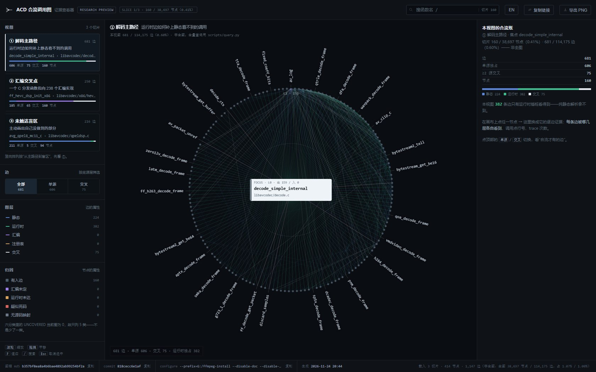
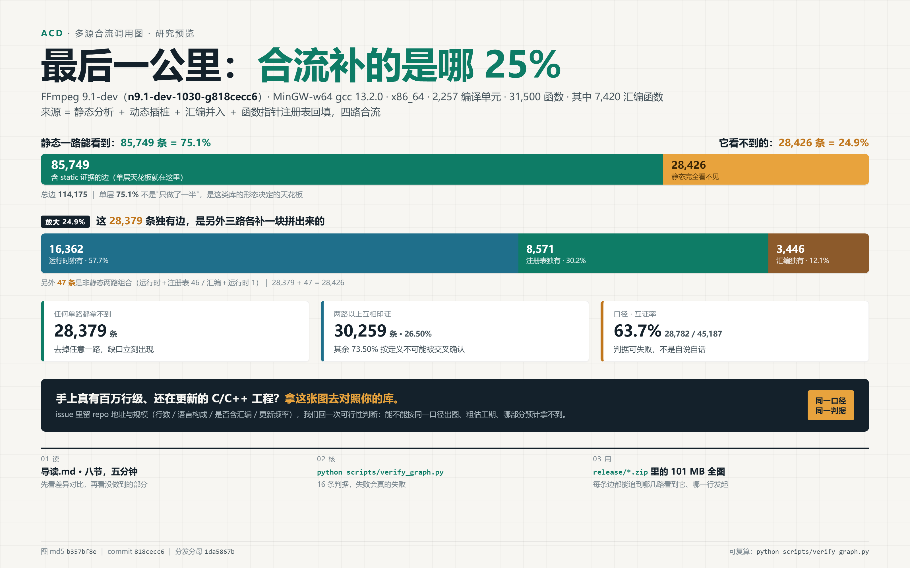
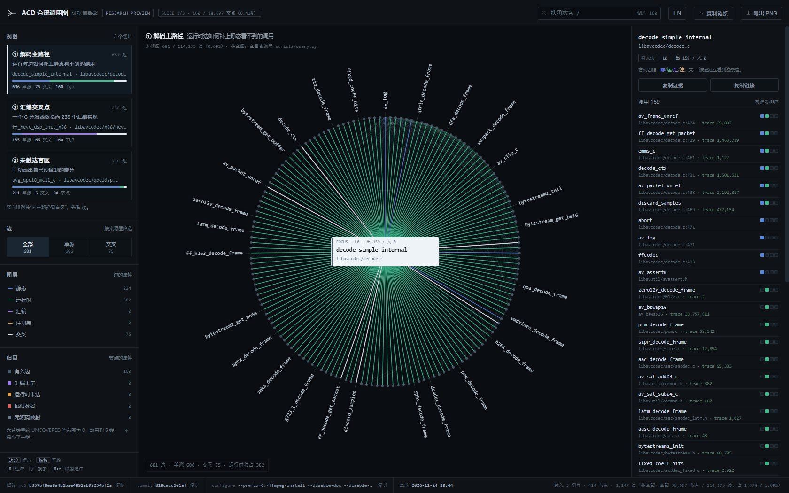

# ACD · 多源合流调用图

> **明鉴AOS** · Agent 操作系统 · 工具总线 / 权限 / 任务 / 长期记忆 / 个人网关

> **EN** — A multi-source fused function-level call graph, validated on FFmpeg:
> **114,175 edges / 38,697 callers / 49.74% function reach** (touched ÷ instrumentable), fused from static parsing (incl. macro expansion),
> runtime instrumentation, disassembly and pointer-registry analysis. Research preview: this repository
> ships **data and methodology**, not a product.
>
> Full English README: [README.en.md](README.en.md) ｜ English guide: [GUIDE.en.md](GUIDE.en.md)

> 在 **FFmpeg 9.1-dev**（`n9.1-dev-1030-g818cecc6`）上的实证：**一个函数级调用图，能同时回答三件事——谁调用谁、还有谁在调用、哪一行发起的调用。**

**先看 [`导读.md`](导读.md)**（英文：[`GUIDE.en.md`](GUIDE.en.md)） —— 三个结论数字、三样我们认为是稀缺的东西、以及我们没做到的部分。

状态：**research preview**（研究预览）

issue 只开两条通道：

- **数据与口径质疑** —— [模板](.github/ISSUE_TEMPLATE/data-caliber-question.md)，带口径名与绑图 md5；
- **建图可行性咨询**（想给自己的仓库出一张同口径的图）—— [模板](.github/ISSUE_TEMPLATE/feasibility-request.md)，留 repo 地址与规模，我们回**一次**可行性判断，**不承诺排期**。

**不接受**“能不能支持 X 语言”这类功能请求。常见问题见 [`docs/faq.md`](docs/faq.md)（[English](docs/faq.en.md)）。

**暂不接受 PR**：本仓是数据发布，改数字或改脚本请先走上面两条 issue 对齐口径；确需改代码时再讨论。

中文界面。查看器顶栏可随时切 `中 / EN`，英文首屏见 [`docs/preview.en.jpg`](docs/preview.en.jpg)。注意内置只有 **3 个切片**（合计 414 节点 / 1,147 边，占全图 1.07% / 1.00%），不是全图。

---

## 它是什么 / 不是什么

**是什么**

- 一个**函数级调用关系图**的构建方法与量化结果；
- 对 FFmpeg 的一次完整实证：**静态解析（含宏展开）、运行时插桩、汇编反汇编、函数指针注册表** 四类来源合流；
- 一份**可核**的报告：每个数字都标了 `[实测]`（直读产物 + 字段路径）或 `[推导]`（附公式），禁止跨口径相减/相除；其中触达率、行号一致率需另配三份外部产物才能复算（见 L1-c 脚注）。

**不是什么**（同等重要）

- 不是 IDE、不是静态分析产品、不做图形编辑器；
- 已实证对象是 C 与汇编；Java / Python / JS **尚未实证**（下一步压测方向是 TypeScript 工程与 DeepSeek harness，暂无数据）；
- 不承诺跨平台：当前口径是 Windows + MinGW-w64 + x86_64；
- 不是“覆盖率 100%”的宣称——本仓主动公开没做到的 13,277 个节点。

---

## 结果（FFmpeg 9.1-dev）

| 指标 | 值 |
|---|---:|
| 图锚点 MD5 | `b357bf8ea8a4b6bae4892ab99254bf2a`（2026-11-14 重写落盘；构建时间 2026-11-11 00:05:58）|
| 报告体所依据的锚点 | `d690c09ef8f148091e95871452a77259`（2026-11-11）|
| FFmpeg commit | `818cecc6e1`（`n9.1-dev-1030-g818cecc6e1`）|
| 调用方节点 | **38,697** |
| 边总数 | **114,175** |
| 最强单层 / 合流补的部分 | **75.1%**（85,749 / 114,175）→ 合流补 **24.9%**（28,426 条不在 static 单层里）|
| ≥2 源交叉确认的边 | **26.50%**（30,259 对）|
| FFmpeg 函数**触达率**（`touched / instrumentable`）| **49.74%**（15,571 / 31,305）|

> 这里刻意**不叫“覆盖率”**：本工具不产出行覆盖/分支覆盖，叫覆盖率会与 gcov 口径混淆。报告体通篇坚持这个措辞，见 [`docs/caliber.md`](docs/caliber.md) §11。

> **两个锚点为什么并存**：报告体（`report/`）写于 11-11，锚点 `d690c09e`；11-14 重写落盘后文件字节差 279 B、md5 变为 `b357bf8e`（构建时间仍是 2026-11-11 00:05:58，元数据只增不改），但**聚合数字完全一致**，且 16 项自洽判据在新图上 16/16 PASS。随附图与 `data/denominator.json` 均绑定 `b357bf8e`。核对时请以所下载文件的实际 md5 为准。

> 报告正文：**[中文](report/ACD-ffmpeg-报告-v4.0.md)** ｜ **[English](report/ACD-ffmpeg-report-v4.0.en.md)**（同一组数字，逐表对照）

> **+33.1% 只是算术比**（28,426 / 85,749），不作收益宣称——为什么不这么讲，见 [`导读.md`](导读.md) 第二节；两个锚点的并存理由与复核路径见 [`docs/anchors.md`](docs/anchors.md)。28,426 与导读里的 28,379 相差 47 条：那 47 条由两条**非 static** 路共同看见（如 runtime+static-reg），单看任一路仍然拿不到。

### 来源分账（4 类产出边 / 6 个引擎）

| 层 | 方法 | 主源边数 | 独占贡献 |
|:--:|:--|--:|--:|
| A | 宏展开（`gcc -E` 后重解析）| 并入 B | 18,745 |
| B | 静态解析（tree-sitter）| 55,539 | 55,537 |
| D | 运行时插桩（`-finstrument-functions`）| 45,187 | 16,362 |
| asm | 汇编（源码 + Capstone 反汇编）| 4,878 | 3,446 |
| static-reg | 函数指针注册表 | 8,571 | 8,571 |

> 两列口径不同，**禁止相加**。「独占贡献」已含在主源边数之内，是“其他层发现不了的边”。
>
> 表里 6 个引擎，**真正产出边的只有 4 类**：宏展开（A）并入静态（B）、LLM 推断（C）在本图冻结为 0 条。所以对外说法是「**4 类来源 / 6 个引擎**」，不是一个虚数。

---

## 先看什么（零安装，30 秒）

双击 **`viewer/acd-viewer.html`**（单文件、无网络依赖、无第三方 CDN）。

| 视图 | 焦点 | 看什么 |
|---|---|---|
| ① 解码主路径 | `decode_simple_internal` | 解码主循环如何分发到各解码器 |
| ② 汇编交叉点 | `ff_hevc_dsp_init_x86` | 一个 C 分发函数指向成片汇编实现——纯静态解析看不到的部分 |
| ③ 未触达盲区 | `avg_qpel8_mc11_c` | 主动画出疑似死码与未触达区域 |

左栏三张视图卡上那行小字，就是每个视图的**论点**；点卡片换视图，右栏随之换成该视图的合流账。

怎么看：

- **边的颜色** = 主导来源层（静态 / 运行时 / 汇编 / 注册表 / 交叉）
- **边的浓淡** = 默认只把焦点的辐条提亮，圈内边留成淡网；点一个节点，只有它那一束亮起来
- **节点** = 环上的点 + 沿半径的函数名；名字染红 = `DEAD_SUSPECT`（疑似，未证实），中性灰 = 有入边
- 点节点看明细：文件、**每条边被哪几层各自独立看到**（右栏四格：静态 / 运行时 / 汇编 / 注册表）、调用点行号、`trace_count`；可「复制证据」或「复制链接」（`#v=…&n=…`，贴出去对方打开就停在同一条边）

右栏就是这张证据页：

**看“合流才有的边”**：左栏「边」有三段 —— `全部` / `单源` / `交叉`。切换后画布左下角的读数条会写明本视图里有多少条边是**单源独占**（另一层根本看不到）。例如解码主路径：681 边中 **382 条只有运行时插桩能看到**，纯静态解析拿不到；汇编交叉点：250 边中 **165 条只有汇编层能看到**。

界面底部固定显示 **图 md5 + FFmpeg commit + configure**，用于核对这张图是否来自真实产物。

> **说明：三个视图都是切片，不是全邻域。** 每个视图的节点数有展示上限（160 / 160 / 94），边是“切片内节点之间的边”。同一个焦点用全图 BFS（`query_call_graph`，depth=1）会得到更大的数——例如解码主路径是 **258 节点 / 3,195 边**。两个数都对，衡量的是不同的东西。

---

## 复现（三级，按需选）

| 级 | 做什么 | 门槛 |
|---|---|---|
| **L0** | 只读报告与视图；比对 md5 | 零，不需要装任何东西 |
| **L1-a** | `python scripts/verify_graph.py acd_graph.json` —— 16 项自洽判据，期望 **16/16 PASS** | Python，约 1 分钟 |
| **L1-b** | `python scripts/export_views.py --graph acd_graph.json` —— 重新导出视角 | Python，约 1 分钟 |
| **L1-c** | `python scripts/denominator_recompute.py --graph acd_graph.json --build-root <构建目录> --asm <汇编表> --touched <edges_fate_*.json> --compare data/denominator.json` —— **把 49.74% 从头算一遍**，期望 16 个字段全部一致 | Python，约 2 分钟 |
| **L2** | 拿一个几文件的小 C 项目端到端建图 | **引擎不在本仓**——见下表下一条 |
| **L3** | FFmpeg 全量 | 约 **3.3–3.6 小时 / 3,011 个 fate 目标** |

> **L1-c 的三个外部产物**（构建目录、汇编表、`edges_fate_*.json`）**不随仓、不随 Release 分发**；缺任一，脚本只能读 `data/denominator.json` 的现值，不能重算 49.74%（会给出一致性差异清单）。

**要建自己的图（L2 / L3）**：本仓交的是数据、方法、判据与口径，**不含构建引擎**。两条路径：(1) 等引擎侧工具链开放——另行发布，**本仓不预告时间**；(2) 按 [`docs/reproduce.md`](docs/reproduce.md) 自己复刻 A / B / D / asm + static-reg 四路再合流。手上有真实工程想按同一口径出图，请按 [建图可行性模板](.github/ISSUE_TEMPLATE/feasibility-request.md) 留 repo 地址与规模，我们回**一次**可行性判断（能不能出图 / 粗估工期 / 哪部分预计拿不到），判断不出来也会直说。问答见 [`docs/faq.md`](docs/faq.md)。

全图 `acd_graph.json` 不在 git 里，见 **Releases**（附 md5）。包里另有 `denominator.json`（**脱敏分发版** 1,955 B / `1da5867b…`，与 `data/` 下同名文件一致）与 `target_set.json`（14,375 条 / `5633cb3a…`），四个成员全部登记在 `MANIFEST.txt`。

复现所需的环境与参数见 [`docs/reproduce.md`](docs/reproduce.md)。

**每个数字的定义、8 条已知边界、6 类缺口归因、以及踩过的 5 个误判**，见 [`docs/caliber.md`](docs/caliber.md)（[English](docs/caliber.en.md)）。这份文档刻意不含数值表——数值只有一处：`data/denominator.json`。

> `docs/caliber.md` 是这套口径的**完整公开版**（口径名、定义、判据、负例一一对应）。逐版修订记录与审计过程在内部维护（商业产品侧资产），不随仓发布——**公开版的每一条判据都能被本仓脚本复现**，包括 `scripts/verify_graph.py`（16 项自洽）与 `scripts/verify_matched_rate.py`（互证率 7 项，含负例）。口径质疑请走 issue，带口径名与绑图 md5。

> 全图 `acd_graph.json`（106 MB）不进 git，放在 **Releases** 里，附 MD5。git 历史里永远不该出现它。

---

## 拿到之后怎么用（解压 / 直接读 zip → 查一个函数 → 看见每路出处）

1. **拿到图**：不用解压——`scripts/query.py` 用标准库 `zipfile` 直接读 `release/` 里那个包；解压了也行，把 `--graph` 指向解压出来的 `acd_graph.json`。**不装依赖，只用标准库**（Python 3）。注意：`release/*.zip` 不入 git，**clone 下来没有这个包**——先从 Releases 下载到 `release/`；缺图时 CLI 会直接点名它找的是哪个文件。
2. **查一个函数**：`python scripts/query.py --callees av_make_error_string`
   → `av_strerror@ffmpeg-src#libavutil#error.c` ｜ `sources=runtime,static` ｜ `confidence=high` ｜ `call_sites=libavutil/error.h:114` ｜ `trace_count=772`
3. **看见每路出处**：`python scripts/query.py --callers filter_frame` 不合并同名——`filter_frame` 的 `static` 同名定义**命中 263 个 id**，逐个列出；`python scripts/query.py --edge av_make_error_string av_strerror` 只看一条边的四路账与调用点行号；`python scripts/query.py --selfcheck` 复核 **114,175 边 / 38,697 caller 键**，一致则退出码 0。

`--limit` 只截断打印、总数照样报；`--json` 出机读版；退出码 0 成功 / 1 无命中 / 2 参数错误 / 3 自检不一致。

**本仓不提供引擎侧 `query_call_graph` 接口，这里给的是只读脚本。** 一页导读见 [`导读.md`](导读.md)。

---

## 许可与边界

- **报告与图数据**：CC BY 4.0（可引用，需署名并保留 md5 与 commit）
- **本仓脚本**：MIT
- 机器可读标识：`scripts/` → `MIT`；`report/`、`docs/`、`viewer/`、根目录文档与图片 → `CC-BY-4.0`。GitHub 会把本仓识别为 “Other”，因为它是双许可；以两个标准文本与本节为准。
- 标准许可文本：[`LICENSE-MIT.txt`](LICENSE-MIT.txt)（脚本）/ [`LICENSE-CC-BY-4.0.txt`](LICENSE-CC-BY-4.0.txt)（文档与图数据）；[`LICENSE`](LICENSE) 为索引
- **FFmpeg 源码**：不在本仓。复现请自行 clone 到 `818cecc6e1`，遵守其 LGPL/GPL 条款。
- 本仓只分发**分析结果**（函数名、文件路径、行号、计数），不分发任何 FFmpeg 源码片段。
- 本仓与 FFmpeg 项目**无隶属、赞助或背书关系**；FFmpeg 名称与标识归其项目所有者，本仓仅在事实性说明中提及。

---

## 关于

**明鉴AOS（Agent 操作系统）** —— 管五件事：工具总线、权限、任务、长期记忆、个人网关。
**不管模型，也不做 IDE。**

- **个人网关**：装在你本机的模型与能力出口；权限、写操作守卫与成本都收在这一处。
- **工具面**：现 90 个，对外会收敛到 40 个左右。

本仓是 **ACD 引擎** 的对外实证——ACD 引擎只是明鉴AOS 里负责代码分析与调用图的那一个模块；C/C++ 是这一模块中已深度适配的一条线，FFmpeg 是这条线上的**压测样本**，不是适用边界。

**Mingjian AOS — Agent OS.** It manages five things: tool bus, permissions, tasks, long-term memory, and a personal gateway on your own machine (the single egress for models and capabilities — permissions, write-guards and cost all land there). It ships no model, and it is not an IDE.

This repository is the public evidence for **one module** of it — the **ACD engine** (code analysis and call graphs). C/C++ is one deeply adapted line inside that module; FFmpeg is the stress sample, not the boundary.

本仓是它的对外实证：先证明“算得对”，再谈“能做什么”。**能证明的范围只有这一张图**——114,175 条边、16 项判据、缺口账全开；别的工程不是跑不了，是没在这个仓里跑给你看，所以数字只绑这一个图 md5，不外推。

产品侧（agent 编排、项目适配、增量更新）**不在本仓**。可举证的样本目前只有 FFmpeg：单次图重建 **1 小时 26 分 38 秒**（D 层复用时的实测，分段依据见 [`导读.md`](导读.md) 第七节）；全流程含 FATE 采集 **3.3–3.6 小时**。历史各次耗时未埋点，因此**不提供累计值**。下一个压测方向是 TypeScript 工程与 DeepSeek harness，暂无数据。
