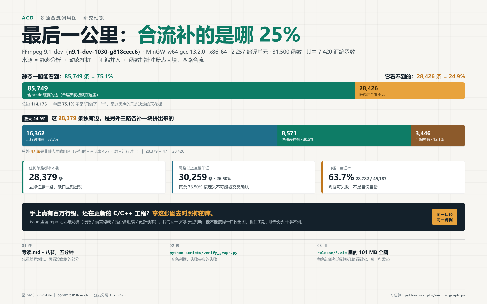

# 导读 · 八节，五分钟

> 本仓是 **明鉴AOS**（Agent 操作系统：工具总线 / 权限 / 任务 / 长期记忆 / 个人网关）里 **ACD 引擎** 模块的对外实证——开源的是证据，不是平台。
>
> **EN** — [GUIDE.en.md](GUIDE.en.md)（同一组数字；两边不一致时以本页为准）

**一张 FFmpeg 的调用图，114,175 条边。每条边带出处；边/节点/来源计数可当场复算，触达率与行号一致率另需三份外部产物（见下文）。**

对象是 **FFmpeg 9.1-dev**（`n9.1-dev-1030-g818cecc6`，MinGW-w64 / x86_64）：2,257 个编译单元、31,500 个函数、7,420 个汇编函数。图由**静态分析 + 动态插桩 + 汇编并入 + 函数指针注册表**四路合流而成——一条边能同时说清「谁调用谁」「还有谁在调用」「哪一行发起的」。

单层最多给到 **75.1%**。剩下 24.9% 只有合流能补：其中 **28,379 条边任何单层都拿不到**，另有 **30,259 条（26.50%）被 ≥2 路独立看见**。

没做到的 **13,277 条边**，按原因分成五类，摆在[第六节](#六我们没做到的先说在前面)同一页上。

不装任何东西：双击 [`viewer/acd-viewer.html`](viewer/acd-viewer.html) 就是三视图查看器；按函数查 `python scripts/query.py --callees <函数名>`（纯标准库，直读 zip，不解压那 101 MB）；自检 `python scripts/query.py --selfcheck` 应报 **38,697 / 114,175**。

---

## 一、这跟现成的调用图有什么不同（先看这里）

**先说结论**：如果只需要一张“函数 A 调了谁”的静态图，`cflow` 就够了，不需要这个仓库。

按能力类别摆一下（**是归类，不是横评**——我们没做过工具基准测试）：

| 类别 | 通常能给到什么 | 这个仓库多出来的 |
|:--|:--|:--|
| 静态单层（`cflow` / Doxygen / IDE 索引）| 一张静态图，节点到函数名 | 单靠这一路就能拿到**四分之三**的边，剩下四分之一它看不见 |
| 动态单层（`gprof` / `callgrind` / `ltrace` / eBPF 采样）| 实际跑过的调用关系 | 运行时边与静态边**并到同一张表**，一条边能直接看出“几路同时看见” |
| 研究界的跨层合并 | 合并方法与评估结论 | 公开的是**同一张图 + 同一套脚本**：收益账可当场重算，不是论文里的一张表 |
| 商业代码平台 / APM | 图 + 查询 + IDE 集成 | 不卖集成。只交数据、口径与判据 |

**合流这件事不是我们发明的**——静态 + 动态合并，学术和工业都做过很多年。我们的选择是把它**做满**（汇编、函数指针注册表都进来，不做“干净版”），并且把**账做开**（每条边的每一路出处、每一处缺口、每一处没做到）。

我们不声称“更准”：边级 precision / recall 未测（报告 §6 #1）。所以这里的对比只在**证据结构**一层，不在精度一层。任何“比某工具更准”的说法，要么给出测法，要么就是营销。

能被当场检验的差异只有四条，全部在仓里：

1. **同名同口径**：一个数字只有一处定义（[`docs/caliber.md`](docs/caliber.md)），口径改了要标 stale；
2. **判据会失败**：`scripts/verify_graph.py` 指向旧图 **14/16 FAIL**；
3. **缺口公开**：13,277 个无入边函数五类归因、15,598 个未触达函数逐类交代；
4. **出处可展开**：每条边的 `sources` 四路各自状态，查看器点一下就看得到。

---

## 二、结论先给（三个数）

| 项 | 值 |
|:--|:--|
| 图规模 | **114,175 条边 / 38,697 个调用方函数**（FFmpeg 9.1-dev，commit `818cecc6`）|
| 最强单层 | **含 `static` 的边 85,749 = 75.1%** —— 单一手段已经能拿到四分之三 |
| 合流才有的部分 | **28,379 条边任何单层都拿不到**（runtime 16,362 + asm 3,446 + static-reg 8,571）；全图另有 **30,259 条（26.50%）被 ≥2 路独立交叉确认** |

**我们不打算说“提升了 33%”**。更准确的说法是：**最强单层已经到 75%，合流的全部价值在最后那 25%**——这 25% 里，运行时独有 16,362 条、汇编独有 3,446 条、注册表独有 8,571 条（注册表边 99.4% 是独有，另两路完全看不见）。这里有两个数别混：**28,426** 是不含 `static` 的边（最后这四分之一），**28,379** 是只被 runtime / asm / static-reg 中**一路**看见的边，差 47 条是两条非 static 路共同看见的组合边——两个都对，量的不是一件事。

同样的数字，前一种说法像营销，后一种像结论。

### 这张图是哪个库，难在哪

**库**：FFmpeg 9.1-dev（`n9.1-dev-1030-g818cecc6`），MinGW-w64 gcc 13.2.0 / x86_64 实测；**2,257 个编译单元、31,500 个函数**，其中 **7,420 个汇编函数**。

**难在哪**（四条各自决定了一部分边为什么只能靠另一路补）：

| 难点 | 具体形态 | 单层为什么看不见 |
|:--|:--|:--|
| 函数指针注册表 | 编解码器/滤镜靠结构体表挂函数（`->decode` 这类间接调用）| 静态解析看得到“读了这个字段”，看不到最终调谁 |
| 宏 + 模板实例化 | DSP 路径靠 `#include` 模板与宏生成成百上千个函数实例 | 名字是宏产物，源码里没有对应的函数定义 |
| 汇编混编 | x86 SIMD 大量 `.asm` / `.S`，符号与调用都在汇编里 | C 侧解析器直接跳过这些文件 |
| 同名多定义 | `static` 作用域下同名函数遍地（`filter_frame` **263 份**、`uninit` **261 份**）| 裸名一对多，必须靠地址反解才能定到文件 |

所以“75.1%”不是我们只做了一半，是**这个库的形态决定了单层的天花板**；剩下的四分之一，只能靠运行时、反汇编、注册表三路各补一块。

---

## 三、三样我们认为稀缺的东西

### 1. 量法可复算，而不是只有一个数

图里每条边有两个源字段：`source`（主源，每条边只有一个，可相加 = 114,175）和 `sources`（全源，含重叠，禁相加）。所以「85,749」和「55,539」是同一个 `static` 的两个口径，不是矛盾——这一点写进了 [`docs/caliber.md`](docs/caliber.md)，也在报告里逐处标注。

数值只有一处：`data/denominator.json`（16 个数值字段）。**边/节点类字段**可直接从图复算；**触达率相关字段**（`touched` / `nt` / `SIMD` / `real_denom` 等）需要构建目录（含 `config.h`）、`asm_capstone_map.json`、D 层 `edges_fate_*.json` 三个外部产物——三者本仓与 Release 均不分发，拿不齐只能读值，不能从头算。凑齐后，16 个字段可全部一致（参数见 `scripts/denominator_recompute.py --help`）。

### 2. 判据会失败，而不只是全绿

`scripts/verify_graph.py` 是 16 项图内自洽判据，当前图 **16/16 PASS**。更关键的是负例：**指向旧图时 14/16 FAIL**——这套判据不是恒真的。一套永远 PASS 的判据等于没有判据。

### 3. 缺口账是公开的，而不是藏起来的

图上给每个函数都带了 `gap_class`：有入边 25,420 / 汇编未定 4,572 / 运行时未定 3,611 / **疑似死码 2,650** / 无文件映射 2,444。后四类合计 **13,277 个无入边函数**，它们在查看器里是画出来的，不是滤掉的。

「疑似死码」是刻意这么叫的：没有入边 + 有文件映射 + 非汇编 + DSP 命名特征，**这只是嫌疑，未证实**。

---

## 四、四个反直觉的发现

**1）1,261 条“自环”不是递归。**
上一版有 1,261 条边被标成“自环误判”。查根因：不是递归，而是身份解析把「同名不同定义」并成了一条边。修完身份后，自环分类共 **85** 处——真递归 72、假阳性 11（已删除）、仅取地址 1、汇编局部标签 1；删除后图内保留 **74** 处（72 + 1 + 1）。总边数从 114,186 降到 114,175，删掉的 11 条逐条有据。

**2）不确定就留空，绝不猜。**
合流后 caller / callee 的 ID **悬空数为 0**。但代价是明说：114,175 条边里，**88,343 条**能唯一确定到文件（带 `@` 的 key），**10,413 条**是跨文件同名只能留裸名，**15,419 条**的 callee 干脆留空——其中 **2,802 条**指向图内宏/内联助手（有 `file_map`、无节点 id，如 `av_bswap32` 1,212 条），**12,617 条**在 `file_map` 里查不到（项目外符号为主，`memcpy` 1,353 / `memset` 1,310 / `abort` 1,014）。这 **25,832** 条不是“缺失”，是守卫**宁可留空也不猜**——外部符号本来就没有源码可定位。

**3）过滤掉 20,879 条噪声边，误伤 0。**
噪声边占过滤前的 **15.45%**：宏名 13,144、模板实例化 7,252、短名噪声 476、C 关键字 6。删完之后专门做了一次误伤审计——**overkill = 0**。删除是这类工具最容易作弊的一步：删多了图表好看、删错了没人发现。所以这一步必须有账。

**4）未触达的函数，一半压根没有调用方。**
未触达集 15,598 个里：**6,232 个既没有入边也不是 SIMD**、8,143 个有入边、1,223 个命中汇编符号表。也就是说，**写测试也调不到**那 6,232 个——这是结构性上限，不是“测试跑得不够多”。

---

## 五、这张图能拿来干什么

| 想要 | 拿去用 | 数字 |
|:--|:--|:--|
| 补测试 | `target_set.json`：未触达且可插桩（已去 SIMD）| **14,375 条** |
| 找疑似死码 | `gap_class = DEAD_SUSPECT` | **2,650 个**（疑似，未证实）|
| 找动态调用 | `source = static-reg`（注册表边）| **8,571 条**（全部 low 置信，标“可能性，非实际发生”）|
| 定位到源码行 | 每条静态边带 `call_sites` | 与运行时地址锚定 **68.48%** |

还有一层是很多调用图不做的：**每条边带置信档**——high **46,619** / medium **58,985** / low **8,571**（low 恰好就是注册表那批）。用的时候可以按档阈值取，而不是把“可能是”和“确实是”混在一起用。

---

## 六、我们没做到的（先说在前面）

- **函数触达率 49.74%**（15,571 / 31,305 可插桩函数）。D 层靠跑 FATE 用例采执行，没被跑到的函数就是没被跑到——这是结构性上限，不是调参问题。
- **13,277 个无入边函数**里，真正能判成“疑似死码”的只有 2,650 个，其余是汇编、函数指针表成员或查不到文件映射。
- **C 层（LLM 推断函数指针表）冻结在 0 条**。候选缺口 92 点，剔除误报后实际可补 36 点，占成员函数指针调用点的 1.32%。补不动，就标冻结。
- **调用点行级锚定 68.48% 无法从图内复算**。它依赖 D 层 trace 与带 DWARF 的二进制，随仓产物里没有——我们在报告里就是这么写的。
- **只在 FFmpeg 9.1-dev / MinGW-w64 / x86_64 上完成实证**。本仓不宣称“支持 C 语言工具链”，只宣称“在这个组合上跑通了，账在这里”。

一个自称全覆盖的调用图，通常只是没把没做到的画出来。

---

## 七、开源边界：证据开源，产品另说

- **开源的是**：方法、这张 114,175 条边的图、三视图查看器、判据脚本、口径文档。全部可以复算、可以质疑、可以引用。
- **不开源的是**：引擎与日常化工作流——把这件事从“3.3–3.6 小时跑一次 FFmpeg”，变成“你自己的仓库里随时能查”的那一层。
- **我们想证明的不是“我们能跑”**，是“**我们敢把账本交出来**”。一个工具值不值得信，看它敢不敢公布自己没做到的部分。

### 产品侧（不属于本仓证据，单独标注）

明鉴AOS 里负责这块的 **ACD 引擎** 把这套合流做成可编排流程：agent 驱动采集、地址反解、合流、校验，针对具体项目适配后，产出**同一口径**的分层调用图（同定义、同判据、同缺口账）。

能举证的样本只有一个——FFmpeg（百万行级 C + 汇编）。数字下面这些，全部有产物时间戳可核：

| 段 | 耗时 | 依据 |
|:--|--:|:--|
| 预检 | **1 分 43 秒** | `meta.precheck.boot_ts` 22:39:20 → `include_map.json` 22:41:03 |
| A 层宏展开 + 行映射（2,257 文件 → 4,514 产物）| **16 分 39 秒** | `data/acd_expanded/` mtime 窗：22:41:03 → 22:57:42 |
| B 层静态边 + 四路合流 + 汇编并入 + 落盘 | **1 小时 8 分 16 秒** | 22:57:42 → 00:05:58（四件事挤在一段，无阶段界标，只能整体给）|
| **单次图重建合计** | **1 小时 26 分 38 秒** | 22:39:20 → 00:05:58 |
| D 层（运行时采集）| 本轮 **0**（复用既有 trace）| `meta.runtime.status = reused` |
| 全流程（含 FATE 采集 9,033 用例）| **3.3–3.6 小时** | 历史实测区间，见 README L3 |

**汇编并入那一段单独的时间：查不到，不拆。** 本轮汇编映射表是复用的（`asm_capstone_map.json` mtime 11-10 12:53:14，早于本次构建；`trace_build/*.o` 最后写于 11-08 04:06），并入过程**不落任何中间产物**——从 22:57:42 到落盘 00:06:06 之间没有任何可切的时间界标。所以这一行里"汇编"只是被枚举出来的动作名，不能当成一个有时间戳的段；宁可整段给，也不按比例瞎拆。

**历史与累计：不给。** 这张图有 **35 次**落盘快照（11-04 → 11-14），但每次的分阶段耗时**从未埋点**，所以没有“累计多少小时”这个数——我们不猜。工业化产出的关键也不是“跑一次多久”，而是“**改一行代码之后多久能更新**”。所以本仓的耗时口径只有一句：**单样本实测 1 小时 26 分 38 秒（FFmpeg，复用既有 trace，即不含运行时采集）；增量速度正在测，暂无公开数据。** 这句话就是我们能负责的全部；再说多一个字都是猜。

**从 2026-11-24 起，引擎自带埋点：此后重建的图会在 `meta.timings` 里记录五段串行 wall-clock。** 本仓发布的这张图生成于 **2026-11-11**，`meta.timings` **不存在**（下面的五段定义是给下一次重建用的）。五段是：`static_acb_s`（include_map + A 层展开 + B 层静态边）/ `runtime_d_s`（D 层）/ `c_layer_s`（LLM 推断）/ `merge_incl_asm_s`（合流 + 汇编 + 过滤）/ `tail_pre_save_s`（缺口分类 + 自环 + 自述重算），另加 `total_to_save_s`。只读观测，不改构建逻辑，异常一律降级为 `instrumented=false`，不会阻断构建。已用一个小工程跑通验证（五段之和 4.390 s vs total 4.389 s，差 0.001 s 为舍入）。注意 `merge_incl_asm_s` 仍是"合流 + 汇编 + 过滤"一段——要让汇编单独成数，得再打一个界标，现在没有加；不给自己造精度。历史那 35 次仍然没有数——**下一次重建会是第一个可核的分阶段样本**。

**能力和证据是两件事，分开说。**

- **能力**：**明鉴AOS**（Agent 操作系统）——管工具总线、权限、任务、长期记忆、个人网关五件事（个人网关 = 装在你本机唯一的模型与能力出口，权限/写守卫/成本都收在这一处），不管模型、也不做 IDE（工具面现 90 个，对外会收敛到 40 个左右）；**ACD 引擎只是明鉴AOS 里负责代码分析与调用图的那一个模块**，agent 驱动采集、地址反解、合流、校验都在这个模块内完成；C/C++ 是这一模块里已深度适配的一条线，FFmpeg 是这条线上的**压测样本**，不是适用边界。
- **证据**：本仓只对这一张图做过逐条复算（114,175 条边、16 项判据、缺口账全开）。别的工程不是跑不了，是**没在这个仓里跑给你看**——所以本文所有数字只绑这一个图 md5，不外推到“任意工程都这样”。

**为什么拿 FFmpeg 当压测。** 它一次踩齐四个坑：函数指针注册表、宏与模板实例化、x86 汇编混编、`static` 同名多定义。这四样是 C/C++ 遗留工程里最坏情况的代理——**能把最难的样本跑通，才有资格谈通用**；反过来，拿一个干净的小库跑出漂亮数字，说明不了任何事。

**下一个压测方向（暂无数据，先说明）。** 不重复跑同类 C 库；下一步是 TypeScript 工程与 DeepSeek harness。跑出来按同一口径出图、公布判据与缺口；跑不出来也照实说。

**有屎山就来敲门。** 手上真有百万行级、还在持续更新的 C/C++ 工程（含汇编更好）？在 [建图可行性模板](.github/ISSUE_TEMPLATE/feasibility-request.md) 里留 repo 地址和规模（行数 / 语言构成 / 是否含汇编 / 更新频率），我们回一次可行性判断：能不能按同一口径出图、粗估工期、哪部分预计拿不到。判断不出来也会直说，不给你画饼。（问答见 [`docs/faq.md`](docs/faq.md)）

> 上面这一层的代码不在本仓。本仓开源的是方法、这张图、判据与口径。

---

## 八、三处最值得质疑的地方（欢迎从这里开始）

1. **85,749 和 55,539 差在哪？** —— 一个是“含 static 的边”，一个是“static 为主源的边”。见 [`docs/caliber.md`](docs/caliber.md) 的口径定义。
2. **26.50% 的交叉确认率是不是很低？** —— 另外 73.50% 是**单源独有边**，按定义就不可能被交叉确认。「26.50% 交叉确认」和「73.50% 独有」是同一件事的两面，不是“质量只有 26%”。
3. **49.74% 能不能叫“覆盖”？** —— 本仓不用“覆盖率”这个词，只用「函数**触达率**」（touched / instrumentable），也说清它不是行覆盖、不是分支覆盖。

---

## 30 秒上手

1. 双击 [`viewer/acd-viewer.html`](viewer/acd-viewer.html)：三个视图，左上角每张卡的第一行小字是这张图想说明的事；点任意节点，右栏给出**每条边被哪几路各自独立看到**、调用点行号、`trace_count`。
2. 打开 [`release/MANIFEST.txt`](release/MANIFEST.txt)：图、分母、目标集各自多少字节、md5 是多少，一页看完。
3. 想复算：`python scripts/denominator_recompute.py --graph acd_graph.json --build-root <构建目录> --asm <汇编表> --touched <edges_fate_*.json> --compare data/denominator.json`，期望 16 个字段一致。
4. 想查具体函数（不用解压 101 MB）：`python scripts/query.py --callees <函数名>` 看它调了谁、每路出处、调用点行号；`--callers <函数名>` 看谁调它（同名定义会**逐个列出**，例如 `filter_frame` 有 263 个）；`--selfcheck` 复核 114,175 边 / 38,697 caller 键。

要看论证过程，读 [`report/`](report/)（中文 [`ACD-ffmpeg-报告-v4.0.md`](report/ACD-ffmpeg-报告-v4.0.md) ｜ English [`ACD-ffmpeg-report-v4.0.en.md`](report/ACD-ffmpeg-report-v4.0.en.md)）；要看边界与禁用说法，读 [`docs/caliber.md`](docs/caliber.md)；要复现，读 [`docs/reproduce.md`](docs/reproduce.md)。
